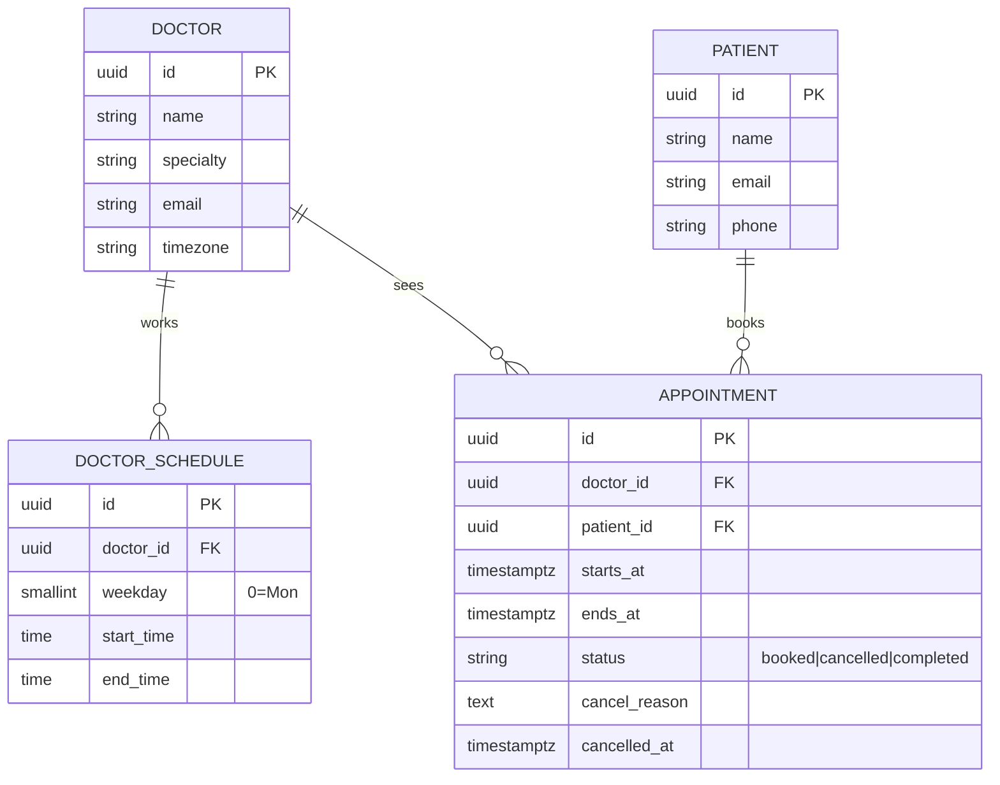

# Clinic Booking API — Savannah Informatics Implementation Engineer assessment

A booking API for a five-doctor clinic: patients see a doctor's free 30-minute
slots on a given day, book one, cancel it, or move it. A booked slot can never
be held by two patients.

| | |
|---|---|
| **Live API** | https://clinic.dabotap.com |
| **Interactive docs (Swagger)** | https://clinic.dabotap.com/docs |
| **Demo UI** | https://chiefbrob.github.io/savannah-clinic-booking/ |
| **Repository** | https://github.com/chiefbrob/savannah-clinic-booking |
| **Stack** | Python 3.12 · FastAPI · SQLAlchemy 2 (async) · PostgreSQL 16 · Alembic |
| **Deployment** | Ubuntu host behind nginx + systemd, deployed by GitHub Actions |

---

## Contents

1. [Quick start](#quick-start)
2. [Section 1 — System design](#section-1--system-design)
3. [Section 2 — API](#section-2--api)
4. [How double-booking is actually prevented](#how-double-booking-is-actually-prevented)
5. [Tests](#tests)
6. [Section 3 — Deployment and CI/CD](#section-3--deployment-and-cicd)
7. [Assumptions and ambiguities](#assumptions-and-ambiguities)
8. [Section 4 — AI reflection](#section-4--ai-reflection)

---

## Quick start

### Docker (one command)

```bash
docker compose up --build          # api on :8000, postgres on :55432
docker compose exec api python -m app.seed
open http://localhost:8000/docs
```

### Local virtualenv

```bash
python3 -m venv .venv && . .venv/bin/activate
pip install -r requirements-dev.txt

cp .env.example .env               # points at localhost:55432
docker run -d --name clinic-pg -p 55432:5432 \
  -e POSTGRES_USER=clinic -e POSTGRES_PASSWORD=clinic -e POSTGRES_DB=clinic postgres:16

alembic upgrade head
python -m app.seed
uvicorn app.main:app --reload
```

Run the tests with `pytest -q` (needs the same Postgres; the suite creates its
own schema in `clinic_test`).

---

## Section 1 — System design

### The domain

Five doctors, each with recurring weekly working hours, divided into
30-minute slots. A patient books one slot with one doctor at a given instant.
The slot then belongs to them until they cancel or move it.

### Components

```
                 ┌──────────────────────────┐
   HTTPS ──────▶ │ nginx (TLS, reverse)     │
                 └────────────┬─────────────┘
                              │ 127.0.0.1:8100
                 ┌────────────▼─────────────┐
                 │ uvicorn → FastAPI        │
                 │  routers (HTTP only)     │
                 │  services (all rules)    │
                 │  SQLAlchemy 2 async      │
                 └────────────┬─────────────┘
                              │ asyncpg
                 ┌────────────▼─────────────┐
                 │ PostgreSQL 16            │
                 │  + partial unique index  │  ← the double-booking guard
                 └──────────────────────────┘
```

| Layer | Responsibility | Why it is its own layer |
|---|---|---|
| `app/api/routers/` | HTTP: parse, delegate, choose status codes | Thin enough to read in one screen; no business rules leak into the transport layer |
| `app/services/` | Validation, slot generation, booking/cancel/reschedule transactions | The rules are the interesting part of the exercise, so they live where they can be unit-tested |
| `app/models/` | Tables, constraints, indexes | The invariants live next to the schema that enforces them |
| `app/core/` | Config, DB session, clock, error types | A single clock and a single error envelope; both are injected, so tests pin time |

### Data model



### Key decisions, and the trade-offs behind them

**1. Slots are derived, not stored.**
A slot is a pure function of (doctor, schedule, date) minus what is booked.
A `slots` table would need a generator job, a cleanup job, and would drift the
moment a doctor's hours changed. Deriving costs a small amount of CPU per
availability request — a five-doctor clinic does not notice — and removes an
entire class of staleness bug.

*Trade-off:* availability is computed per request, so at a scale where a single
doctor has thousands of bookings per day you would materialise a forward window
(e.g. 60 days) instead. The API shape would not change.

**2. The database, not the application, guarantees uniqueness.**
A partial unique index over `(doctor_id, starts_at)` covering only `booked`
rows. See [below](#how-double-booking-is-actually-prevented).

*Trade-off:* this is Postgres-specific. On MySQL you would need a generated
column (or a `slots` row per bookable slot) to approximate it, or fall back to
`SELECT ... FOR UPDATE` on the doctor row, which serialises bookings per doctor.

**3. Working hours are wall-clock times in the clinic's timezone; instants are UTC.**
`08:00` means 08:00 in Nairobi, stored as `05:00Z`. Slots are built by
advancing *local* time, so a DST change (Nairobi has none, but the code should
not care) moves the UTC offset rather than shifting the schedule.

**4. Cancellation is soft.**
The row stays with `status = 'cancelled'`, the reason, and a timestamp. That
keeps an audit trail, lets a patient see what they cancelled, and — because the
unique index excludes cancelled rows — frees the slot in the same statement.

**5. Reschedule is an update, not cancel-then-create.**
One `UPDATE` moves the appointment. The old slot leaves the index and the new
one enters it inside one transaction, so there is no instant where the patient
holds both slots or neither. It also preserves the appointment's identity and
history.

**6. One error envelope, stable machine-readable codes.**
`{"error": {"code", "message", "details"}}` everywhere, including framework-level
404s and validation failures. Clients branch on `code`; humans read `message`.

**7. The clock is a dependency.**
`get_now()` is injected, so "in the past" and "within the next hour" are tested
by overriding a value, not by sleeping or by being flaky at midnight.

---

## Section 2 — API

Base URL: `https://clinic.dabotap.com` · Swagger: `/docs` · OpenAPI: `/openapi.json`

| Method | Path | Purpose |
|---|---|---|
| `POST` | `/appointments` | Book a slot |
| `GET` | `/doctors/{id}/availability?date=YYYY-MM-DD` | Free 30-min slots for that doctor on that day |
| `PATCH` | `/appointments/{id}/cancel` | Cancel with a reason; the slot becomes bookable again |
| `PATCH` | `/appointments/{id}/reschedule` | Move to a new slot, validated like a fresh booking |
| `GET` | `/patients/{id}/appointments` | Upcoming appointments, soonest first *(bonus)* |
| `GET` | `/doctors`, `/patients`, `/appointments/{id}` | Convenience reads for the UI |
| `GET` | `/health` | Liveness + database check |

### Status codes

| Code | When |
|---|---|
| `201` | Appointment created (`Location` header points at it) |
| `200` | Read, cancel, or reschedule succeeded |
| `400` | Well-formed but semantically invalid: outside working hours, misaligned, in the past, too soon, unknown slot |
| `404` | Doctor, patient, or appointment does not exist |
| `409` | Slot already taken; already cancelled; rescheduling a cancelled appointment |
| `422` | The body itself is malformed (missing field, naive datetime, reason too short) |

`400` vs `422` is deliberate: `422` means "your request could not be parsed into
a valid shape", `400` means "parsed fine, but the clinic's rules say no".

### Error codes

`slot_taken` · `slot_not_aligned` · `outside_working_hours` ·
`appointment_in_past` · `booking_too_soon` · `doctor_not_found` ·
`patient_not_found` · `appointment_not_found` · `appointment_already_cancelled` ·
`appointment_cancelled` · `validation_error` · `not_found`

### Example

```bash
curl -s https://clinic.dabotap.com/doctors | jq '.[0]'

curl -s "https://clinic.dabotap.com/doctors/$DOCTOR_ID/availability?date=2026-10-30" | jq

curl -s -X POST https://clinic.dabotap.com/appointments \
  -H 'content-type: application/json' \
  -d '{"doctor_id":"…","patient_id":"…","starts_at":"2026-10-30T09:00:00+03:00"}' | jq
```

```json
{
  "id": "75db6b42-264a-47ea-a70c-5206cc44e67d",
  "doctor_id": "d8a9b989-3c89-55c7-a403-ab1084ef8da2",
  "patient_id": "d121ebe5-4d02-5cfb-b4c3-bee9587da757",
  "starts_at": "2026-10-30T06:00:00Z",
  "ends_at": "2026-10-30T06:30:00Z",
  "status": "booked",
  "cancel_reason": null,
  "cancelled_at": null,
  "created_at": "2026-10-23T18:59:49.983025Z"
}
```

Booking the same slot again returns:

```json
{
  "error": {
    "code": "slot_taken",
    "message": "That slot was just booked by someone else. Pick another slot.",
    "details": {"doctor_id": "d8a9…", "starts_at": "2026-10-30T06:00:00+00:00"}
  }
}
```

---

## How double-booking is actually prevented

The requirement is one sentence — *"Once booked, that slot must not be available
to others"* — and it is a concurrency requirement, not a validation one.

The naive implementation is a check-then-act race:

```python
if await is_free(slot):        # two requests both see "free"
    await book(slot)           # both insert; slot is booked twice
```

The code still contains that check, but only to produce *good error messages*.
Correctness comes from the schema:

```sql
CREATE UNIQUE INDEX ix_appointments_no_double_booking
    ON appointments (doctor_id, starts_at)
    WHERE status = 'booked';
```

Why this works:

* **Atomic.** Two concurrent inserts for the same `(doctor_id, starts_at)` cannot
  both commit — Postgres makes the second wait on the index entry, then fail
  with a unique violation once the first commits.
* **Selective.** `WHERE status = 'booked'` means cancelled rows are ignored, so a
  cancelled slot is instantly re-bookable, and history is kept.
* **No locks in application code.** No `SELECT … FOR UPDATE`, no per-doctor
  mutex, no Redis lock — nothing to forget, expire, or deadlock.
* **Cheap.** One index entry per booking; the availability query never scans
  cancelled rows for the guard.

The application catches the unique violation and returns `409 slot_taken`:

```python
try:
    await session.flush()
except IntegrityError as exc:
    await session.rollback()
    if _is_double_booking(exc):      # constraint name in the driver error
        raise Conflict(..., code="slot_taken")
    raise
```

`tests/test_concurrency.py` proves it: ten simultaneous `POST /appointments` for
the same slot produce exactly one `201` and nine `409`s, and the database holds
exactly one booked row.

---

## Tests

37 tests, run against a real PostgreSQL (no SQLite, so the partial index is the
real thing). `pytest -q`.

| Area | Covered |
|---|---|
| Availability | full day = 16 slots, booked slots disappear, split shifts, days off, the 1-hour lead time, unknown doctor |
| Booking | happy path, 30-minute length, duplicate → 409, outside hours, misaligned (`10:15`), in the past, inside the lead time, exact lead-time boundary, unknown doctor/patient, naive datetime → 422 |
| Cancellation | reason + timestamp recorded, slot becomes bookable again, double cancel → 409, unknown appointment, blank reason → 422 |
| Reschedule | moves and frees the old slot, target taken → 409 with the original intact, cancelled appointment → 409, validates like a fresh booking, same-slot no-op |
| Concurrency | 10 racing bookings → 1 winner / 9 conflicts; parallel bookings on distinct slots all succeed; cancel + re-book never leaves two active bookings |
| Patients | upcoming only, sorted, cancelled excluded, `include_past` |
| Platform | health check, error envelope on unknown routes, OpenAPI served |

Time is pinned (`FIXED_NOW`, a Monday) and injected through `get_now`, so
"past"/"too soon" tests are deterministic rather than dependent on the wall clock.

---

## Section 3 — Deployment and CI/CD

### Where it runs

| | |
|---|---|
| Public URL | **https://clinic.dabotap.com** |
| Host | a single Ubuntu 24.04 VPS, alongside other unrelated sites |
| Process | `uvicorn` (2 workers) on `127.0.0.1:8100`, under systemd |
| Database | PostgreSQL 16 on the same host, own role + database |
| TLS | Let's Encrypt via `certbot --nginx`, HTTP→HTTPS redirect |
| Static demo | GitHub Pages (this repo's `docs/`) |

The service unit is hardened (`ProtectSystem=strict`, `NoNewPrivileges`,
`PrivateTmp`, dedicated `clinic` user) and `Restart=always`.

### Pipeline

Two workflows:

**`.github/workflows/ci.yml` — every pull request, and every push to `main`**

1. Start a `postgres:16` service container.
2. `ruff check` + `ruff format --check`.
3. `pytest -q` (37 tests, including the concurrency test).
4. `alembic upgrade head` against an empty database, proving the migration is
   not just "works on my schema".

**`.github/workflows/deploy.yml` — after CI succeeds on `main`**

1. Triggered by `workflow_run` on the CI workflow, and gated on
   `conclusion == 'success'` and `head_branch == 'main'` — so a merge to `main`
   deploys, and a failing CI never reaches production.
2. SSH to the host with a dedicated deploy key (repo secrets: `VPS_SSH_KEY`,
   `VPS_HOST`, `VPS_PORT`, `VPS_USER`; host key pinned via `ssh-keyscan`).
3. `deploy/remote-deploy.sh` on the host: `git fetch` + `reset --hard
   origin/main`, `pip install`, `alembic upgrade head`, `systemctl restart`,
   then poll `/health` and fail the job if it does not come up (dumping
   `journalctl` when it doesn't).
4. The workflow then curls `https://clinic.dabotap.com/health` from outside, so
   the pipeline verifies the public URL, not just the local process.

**Branch that triggers deployment:** `main`. Merging a PR is the only way a
change reaches production; `workflow_dispatch` exists for recovery.

### First-time provisioning

`deploy/provision.py` (run once, as root, from `/srv/clinic-booking`) creates the
system user, the Postgres role/database, the virtualenv, the systemd unit and
the nginx server block, and writes `.env` if absent without overwriting it.

---

## Assumptions and ambiguities

Where the brief left room, I chose and recorded it:

1. **Working hours are recurring per weekday.** `DoctorSchedule` rows, one or
   more per weekday, so split shifts work. One-off leave/holidays would be a
   `schedule_exceptions` table; not built, because the brief describes fixed
   hours. The availability service would gain one filter.
2. **One clinic, one timezone.** `Africa/Nairobi`. A doctor carries a
   `timezone` column so a second branch could differ, but there is no
   per-branch model — that is the next real scaling step, not this one.
3. **No authentication.** Patients are records, not users; the brief is about
   booking mechanics. Production would put this behind auth and scope
   `GET /patients/{id}/appointments` to the caller.
4. **A 1-hour lead time applies to availability as well as booking** (the
   bonus rule), so the UI never offers a slot that would be rejected. Booking
   exactly 60 minutes ahead is allowed — the boundary is inclusive.
5. **Cancelling a past appointment is allowed**; the brief only forbids
   cancelling twice.
6. **`completed` exists in the status enum** but nothing sets it yet — a
   nightly job would. It is there so the state machine does not need a migration
   later.
7. **No pagination** on list endpoints; with five doctors and one patient's
   appointments it would be noise. `GET /patients/{id}/appointments` is indexed
   on `(patient_id, starts_at)` and ready for it.

---

## Section 4 — AI reflection

**1. What did I use AI for across the four sections?**

Scaffolding and boilerplate: the SQLAlchemy 2 async models, the Alembic
environment, Dockerfile/compose, the GitHub Actions YAML, and the first draft of
this README. It also wrote most of the test file skeleton and the seed data.

I did **not** use it to decide the design. The slot model (derived vs stored),
where the concurrency guarantee lives, the UTC-vs-wall-clock split, and the
`400`/`409`/`422` boundaries are decisions I made and then asked it to
implement.

**2. One example where an AI suggestion improved the work.**

I prompted: *"My booking endpoint does `check if the slot is free, then insert`.
That races under concurrent requests. What are my options in Postgres, and what
are the trade-offs?"*

It offered three: `SERIALIZABLE` isolation, `SELECT … FOR UPDATE` on the doctor
row, or a partial unique index on `(doctor_id, starts_at) WHERE status =
'booked'`. The third was better than what I had in mind — it lets the database
reject the duplicate without any lock held across the request, and it
disappears the moment a booking is cancelled instead of needing a "free the
slot" write. I kept it and wrote `test_concurrency.py` to prove it.

**3. One example where AI output was wrong or incomplete, and how I caught it.**

The first version of the conflict handler looked reasonable but read
`doctor.id` to build the `409` body *after* `await session.rollback()`. A
rollback expires the ORM instance, so that attribute access tried to refresh
from the database outside SQLAlchemy's greenlet context, and the request died
with `MissingGreenlet` instead of returning `409`. Two tests failed
(`test_second_booking_for_the_same_slot_is_409` and the concurrency test), which
is how I found it; the fix is to capture the id before the flush.

A second one: the `422` handler passed `exc.errors()` straight into the JSON
response. Pydantic puts the original `ValueError` object under `ctx`, which is
not JSON-serialisable, so a naive datetime produced a `500`. The
naive-datetime test caught it; the handler now stringifies `ctx` values.

A third one only appeared in production. The systemd unit it drafted had
`ProtectHome=true` for hardening, and asyncpg probes `$HOME/.postgresql/postgresql.key`
for client certificates before connecting. With the home directory unreadable that
`os.stat` raised `PermissionError`, and every request failed to reach Postgres —
`/health` reported `database: unavailable` while `psql` from the shell worked fine.
The health check had been swallowing the traceback, so the fix was two-part: log
the exception (it does now), and set `Environment=HOME=/srv/clinic-booking` in the
unit rather than weakening the sandbox.

**4. Two decisions I made without AI, and why I trusted my judgment.**

*Timezone handling.* I chose to store instants in UTC but express working hours,
and generate slots, in the clinic's wall clock — because "the clinic opens at
8" is a wall-clock statement, and converting a stored UTC schedule back and
forth is how DST bugs get in. The AI initially offered a UTC-only model; I
rejected it.

*Soft cancellation.* I chose to keep cancelled rows rather than delete them.
The brief only says the slot must become bookable again, and deleting would
have done that too — but a clinic needs to know who cancelled what and why,
and a deleted row cannot answer that. The partial index makes keeping history
free, which is what made the choice easy.

---

## Repository layout

```
app/
  main.py                 app factory, error handlers, OpenAPI description
  core/                   config · db session · clock · error types
  models/                 doctor · schedule · patient · appointment (+ the index)
  schemas/                pydantic request/response models
  services/               availability (slot generation) · booking (transactions)
  api/routers/            doctors · appointments · patients · health
tests/                    37 tests incl. test_concurrency.py
migrations/               alembic (0001_initial holds the partial unique index)
deploy/                   systemd unit · nginx · provision.py · remote-deploy.sh
docs/                     GitHub Pages demo site
.github/workflows/        ci.yml · deploy.yml
```
