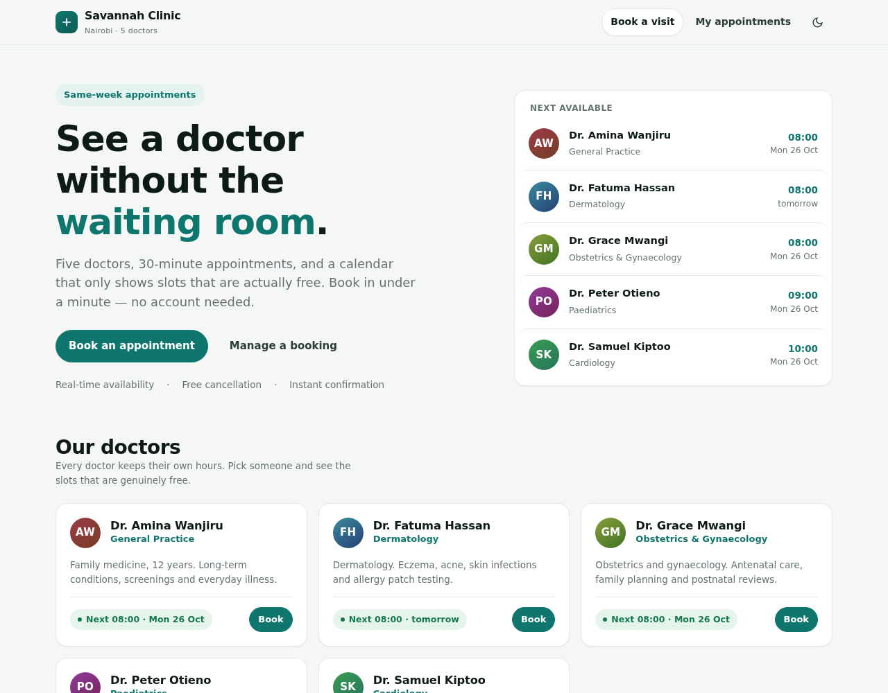

# Clinic Booking API — Savannah Informatics, Implementation Engineer

Booking for a five-doctor clinic: patients see a doctor's genuinely free
30-minute slots, book one, cancel with a reason, or move it.
**A slot can never be held by two patients.**

| | |
|---|---|
| App | **https://clinic.dabotap.com** |
| API docs (Swagger) | https://clinic.dabotap.com/docs |
| Repository | https://github.com/chiefbrob/savannah-clinic-booking |
| Stack | Python 3.12 · FastAPI · SQLAlchemy 2 (async) · PostgreSQL 16 · Alembic |



## Run it

```bash
docker compose up --build
docker compose exec api python -m app.seed
# app http://localhost:8000 · docs /docs · tests: pytest -q
```

---

## Section 1 — System design

**Models.** `doctors` (name, speciality, timezone) · `doctor_schedules`
(recurring weekly windows, one row per working block, so split shifts work) ·
`patients` · `appointments` (doctor, patient, UTC start/end, status, cancel
reason, note).

**Components.** nginx → uvicorn/FastAPI (`api/routers`: HTTP only → `services`:
all rules → `models`: schema and constraints) → PostgreSQL. The clock and the
error envelope are injected, so tests pin time and shape.

**Decisions and trade-offs**

- **Slots are derived, never stored.** A slot is a function of
  (doctor, schedule, date) minus active bookings — no generator job, no stale
  rows when a doctor's hours change. *Trade-off:* computed per request; beyond a
  handful of doctors you would materialise a forward window.
- **The database owns the uniqueness invariant**, not the application. *Trade-off:*
  Postgres-specific; MySQL would need a generated column or `SELECT … FOR UPDATE`.
- **UTC instants, wall-clock working hours.** "08:00" means 08:00 in Nairobi;
  slots advance in local time, so a DST change cannot shift the schedule.
- **Cancellation is soft** — row kept with status and reason, slot freed through
  the index, audit trail intact.
- **Reschedule is a single UPDATE** — no window where the patient holds both
  slots or neither.

---

## Section 2 — API

| Method | Path | Purpose |
|---|---|---|
| `POST` | `/appointments` | Book; validates hours, grid, past, lead time |
| `GET` | `/doctors/{id}/availability?date=` | Free 30-min slots for that day |
| `PATCH` | `/appointments/{id}/cancel` | Cancel with a reason; slot reopens |
| `PATCH` | `/appointments/{id}/reschedule` | Move; validated like a new booking |
| `GET` | `/patients/{id}/appointments` | **Bonus:** upcoming, sorted by date |
| `GET` | `/doctors/next-available` | Soonest free slot per doctor |
| `GET` | `/doctors/{id}/availability/summary` | Free-slot count per day |

`201` booked · `200` read/cancel/reschedule · `400` rule violation (outside
hours, misaligned, past, too soon) · `404` unknown · `409` conflict (slot taken,
already cancelled) · `422` malformed body.

Every failure uses one envelope — `{"error":{"code","message","details"}}` — with
a stable `code` for clients and a readable `message` for humans.

**How double-booking is actually prevented.** Validation produces good error
messages; it is not what protects the slot. This is:

```sql
CREATE UNIQUE INDEX ix_appointments_no_double_booking
    ON appointments (doctor_id, starts_at)
    WHERE status = 'booked';
```

Atomic (two concurrent inserts cannot both commit), selective (cancelled rows
leave the index, so cancelling frees the slot in the same statement), and
lock-free (nothing in application code to expire or deadlock). The unique
violation becomes `409 slot_taken`.

`tests/test_concurrency.py`: ten simultaneous bookings of one slot → exactly one
`201` and nine `409`s. On the live instance, six concurrent POSTs returned one
`201` and five `409`s.

**Bonus: no bookings within one hour.** Enforced twice — `POST /appointments`
rejects it (`400 booking_too_soon`), and availability never lists a slot inside
the window, so the UI cannot offer what the API would reject. The boundary is
inclusive: exactly 60 minutes ahead is allowed.

---

## Tests

50 tests against a real PostgreSQL (no SQLite, so the partial index is real).
`pytest -q`.

- **Availability** — full day, booked slots disappear, split shifts, days off,
  the one-hour window, unknown doctor.
- **Booking** — happy path, duplicate → `409`, outside hours, misaligned, past,
  inside the lead time, exact boundary, unknown doctor/patient, naive datetime → `422`.
- **Cancellation** — reason recorded, slot reopens, double cancel → `409`.
- **Reschedule** — frees the old slot, target taken → `409` with the original
  intact, cancelled → `409`, same-slot no-op.
- **Concurrency** — 10 racing bookings → 1 winner; distinct slots all succeed;
  cancel + re-book never leaves two active bookings.
- **Registration & calendar** — duplicate email → `409`, lookup, summary and
  per-day endpoints agree.

Time is pinned (`FIXED_NOW`) and injected, so "past" and "too soon" are
deterministic instead of wall-clock dependent.

---

## Section 3 — Deployment and CI/CD

| | |
|---|---|
| Public URL | **https://clinic.dabotap.com** |
| Host | Ubuntu 24.04 VPS; uvicorn (2 workers) on `127.0.0.1:8100` under systemd |
| Database | PostgreSQL 16, own role and database, same host |
| TLS | Let's Encrypt via certbot, HTTP→HTTPS redirect |

The app is static (three files), served by nginx from the same origin as the
API — so the browser talks to one host and production needs no CORS.

**Pipeline.** `ci.yml` runs on every pull request and every push to `main`:
spin up `postgres:16`, `ruff check` + `ruff format --check`, `pytest -q`, then
`alembic upgrade head` against an empty database so the migration is proven, not
assumed.

`deploy.yml` fires on CI success for `main` (`workflow_run`, gated on
`conclusion == 'success'` and `head_branch == 'main'`), SSHes to the host with a
dedicated deploy key, runs `deploy/remote-deploy.sh` (`git reset --hard
origin/main` → `pip install` → `alembic upgrade head` → restart → poll
`/health`), then curls the public URL from outside. A failing CI never reaches
production.

**Branch that triggers deployment: `main`.**

---

## Assumptions

Where the brief left room, I chose and recorded it:

1. **Recurring weekly hours**, with multiple blocks per weekday for split shifts.
   Holidays/leave would be an exceptions table; not built.
2. **One clinic, one timezone** (`Africa/Nairobi`). The doctor row carries a
   timezone so a second branch could differ.
3. **No authentication** — patients are records, not users. Production would
   scope the patient endpoints to the caller.
4. **The one-hour lead time applies to availability too**, so the UI never
   offers a slot that would be rejected.
5. **Cancelling a past appointment is allowed**; the brief only forbids
   cancelling twice.

---

## Section 4 — AI reflection

**1. What did I use AI for across the four sections?**

As a fast pair, not an architect. It scaffolded things I could already specify —
the FastAPI/Alembic wiring, the Dockerfile, the Actions YAML, the test matrix
generated from my own list of rules, and the three front-end files written from
a described design. I also used it as a reviewer: asking it to attack the design
for races, timezone bugs and error-taxonomy inconsistencies, then deciding which
objections were real. The judgement calls stayed mine — what the model is, where
the concurrency guarantee lives, what "free" means, and what to leave out.

**2. One AI suggestion that improved the work — and the prompt.**

I had been told to deploy on GitHub Pages. I asked:

> *"The brief says deploy with GitHub Pages. This is a FastAPI + PostgreSQL
> service. Can that work, and if not, what's the best option given I already run
> a VPS with nginx?"*

The answer was that Pages serves static files only, so the API cannot run there —
and that the constraint was actually useful: keep the UI static, serve it from a
subdomain on my own VPS behind nginx, and leave Pages as a mirror.

That reframed the problem from "where do I host this" to "what has to be static
for the constraint to be harmless". It made the app build-step-free on purpose:
one origin for app and API (no CORS in production), no cold starts or sleeping
free tiers during review, the same deploy path I already operate, and a first
click that lands on a real app instead of a docs page.

**3. One example where AI output was wrong or incomplete, and how I caught it.**

It was wrong in the way that matters: it looked finished. The API passed 50
tests and the UI rendered, but clicking through it exposed three defects no unit
test would catch —

- the primary **"Book an appointment"** button only scrolled to the doctor list.
  Wired up, functionally dead;
- a `min-width: auto` grid bug pushed the booking form off-screen at laptop width;
- nginx served the app shell with `max-age=300`, so a deploy could leave a
  reviewer running yesterday's JavaScript.

I caught them by driving the real thing: headless Chrome over the DevTools
Protocol, through the actual flow — book → reschedule → cancel — at 1280px and
390px, with the cache disabled to separate a stale asset from a genuine bug. The
button only showed up because I clicked it; the caching bug only showed up
because the same click worked locally and "did nothing" on production.

**4. Two decisions I made without AI, and why I trusted my judgement.**

**No patient accounts.** Patients are records, booking is open, bookings are
found by email. The brief is about slot integrity and API correctness; auth would
have consumed the time budget and buried the part being assessed behind a login
screen. I would rather show the concurrency work than a half-built auth system.

**No front-end framework and no build step.** Three static files. A
`node_modules` toolchain is the most likely thing to break on a reviewer's
machine or in CI, and a build artefact can silently drift from the API it talks
to. Static files are testable with `curl`, served by nginx, and mirrored to Pages
unchanged. That is a judgement about failure modes, not about tooling fashion.
